# Maestro



**Maestro runs your team's software-delivery process inside your AI coding assistant — the same
steps, in the same order, with a human approving at the points that matter.**

It's built for teams whose product spans **several repos** (frontend, backend, services). Maestro
keeps one shared, up-to-date **knowledge base** of all those repos, and lets you deliver **one
feature across several repos** in a single run: one requirement, one design, coordinated changes
in every repo that needs them.

You describe the process once as a workflow file (for example: requirements → design → review →
build → test). Then anyone on the team types `/maestro my-feature` in Claude Code, Codex or
Cursor, and Maestro walks the AI through that exact process. It runs each step, stops to ask you
at each decision, and saves every result as a file in your repo.

> **New here?** Read [What can you do with it](#what-can-you-do-with-it), then follow
> [Prerequisites](#prerequisites) → [Install](#install) → [Start your first feature](#start-your-first-feature).

## What can you do with it

- **Change several repos for one feature.** One PRD and one high-level design cover the whole
  feature. Each affected repo then gets its own detailed design, approved by the team that owns it,
  and its own isolated branch for the code changes. The repos share one API contract, so frontend
  and backend build against the same interface.
- **Keep a knowledge base of all your repos.** Maestro writes and maintains docs for every repo
  (architecture, technical and functional docs per area, a codebase map per repo). Every design
  step reads them, and they're refreshed after each feature, only for the parts that changed.
- **Build a feature end to end** with the included pipeline: requirements (PRD) → high-level
  design → detailed design per repo → API contract → review → implementation → QA.
- **Stay in charge.** Maestro stops at approval points ("gates") and asks you instead of guessing.
- **Stop and come back anytime.** Progress is saved after every step. Resume exactly where you
  left off, even on another machine.
- **Make your own processes.** Draw a workflow in the visual builder or write a short YAML file.
- **Use any skills.** Each step can use the included skills, your own, or a third-party pack.
- **No extra cost or setup.** It runs on the AI assistant you already use: no API key, no server,
  nothing to `pip install`.

## How it works

```
 you ── /maestro my-feature ──►  your AI assistant (Claude Code / Codex / Cursor)
                                     │ "what's next?"         ▲ "done, here's the result"
                                     ▼                        │
                           Maestro engine (a small Python program in your repo)
                           reads the workflow and decides the ONE next step
                                     │
               ┌─────────────────────┼──────────────────────┐
               ▼                     ▼                      ▼
        an AI worker runs      a script runs          you answer a question
        a step (writes a file) (checks, tests)        or approve a gate
```

- **The workflow** (a `.yaml` file) lists the steps, their order, and where you approve.
- **The engine** decides what happens next. The AI never improvises the order, and a step only
  counts as done when its output file really exists.
- **Your progress** is saved in `.maestro/runs/<feature>/`, so a run can always resume.

## Prerequisites

| You need | Check with |
|---|---|
| An AI coding assistant: **Claude Code**, **Codex** or **Cursor** | — |
| **python3** 3.8 or newer (nothing extra to install) | `python3 --version` |
| **git**, **bash** and **curl** | `git --version` |
| **macOS or Linux** (on Windows, use WSL) | — |

Every repo that Maestro will change needs at least one commit, because Maestro builds each repo in
its own `git worktree`.

## Set up your workspace

**Working in one repo?** Skip this section and install Maestro in that repo's root folder.

**Does your feature touch several repos (for example frontend + backend)?** Create an
**umbrella workspace**: a new parent folder, with its own git repo, where you install Maestro and
clone your service repos. This is what makes the multi-repo features work:

- The AI sees **every repo at once**, so it designs across them instead of guessing about the
  repos it can't see.
- The **knowledge base** covers all the repos in one place.
- Each feature's change can span **any of the repos**, each still changed on its own branch.

```
my-project/                  ← umbrella repo: install and run Maestro here
├── codebase/                ← your service repos, cloned here (gitignored by the umbrella)
│   ├── frontend/            ←   still its own repo: own branches, PRs and CI
│   └── backend/
├── docs/                    ← the shared knowledge base across all repos (Maestro writes it)
└── .maestro/                ← added by the installer (see below)
```

Each service repo stays independent; this is **not** a monorepo. Full walkthrough:
[docs/umbrella-workspace.md](docs/umbrella-workspace.md).

### What Maestro adds to your repo

```
.maestro/
├── workflows/        the workflows you run: the included pipeline and your own
├── runs/<feature>/   one folder per feature: requirements, every output, saved progress
├── memory/           lessons learned across features
└── engine/  ui/      Maestro's program and the visual builder (replaced on upgrade)
.claude/  .cursor/  or  .agents/     the AI skills (replaced on upgrade)
maestro               helper: ./maestro ui (builder) · ./maestro install (upgrade)
```

Commit `.maestro/workflows/`, `.maestro/runs/`, `.maestro/memory/`, `.maestro/docs/` and
`.maestro/workflow-manifest.json`. `./maestro help` prints a ready-made `.gitignore` for the rest.

## Install

**1. Install.** From the root of your repo (or umbrella workspace):

```bash
curl -fsSL https://raw.githubusercontent.com/KeyValueSoftwareSystems/kv-skills/main/install.sh | bash -s -- claude-code
```

Use `codex` or `cursor` instead of `claude-code`, or list several.

**2. Set up once.** Open your assistant in the same folder and run:

| Claude Code / Cursor | Codex |
|---|---|
| `/maestro-init` | `$maestro-init` |

This detects your tech stack, installs only the matching skills, and builds the **knowledge
base**: an architecture overview of how your repos connect, technical and functional docs per area
in `docs/`, and a `docs/codebase-map.md` inside each repo. Every design step reads these.

You don't need to maintain the docs by hand. Maestro records which commit each doc describes, so
re-running `/maestro-init` only re-reads what changed, and each finished feature refreshes the docs
for the areas it touched.

> Using a private fork? `curl` can't log in. Clone the repo and run `./install.sh claude-code`
> from the clone instead.

## Start your first feature

1. **Start it** in your assistant:
   ```
   /maestro add phone OTP login        # Claude Code / Cursor
   $maestro add phone OTP login        # Codex
   ```
   Maestro names the run `add-phone-otp-login` and creates `.maestro/runs/add-phone-otp-login/`.
2. **Add your requirements (optional).** Put notes, tickets or an existing PRD in
   `.maestro/runs/<feature>/requirement/`. If the folder is empty, Maestro asks you instead.
3. **Answer its questions.** Maestro asks only about decisions it can't make on its own. Each
   question shows a recommendation and alternatives. Pick one, type your own answer, or say you
   want to discuss it.
4. **Approve at gates.** At each approval point you choose **Approve** or **Revise** (and say what
   to change).
5. **Find the results** in `.maestro/runs/<feature>/`: PRD, designs, API contract, test cases and
   review reports.

**When the feature spans several repos,** the run fans out and back in:

```
one PRD → one high-level design ─┬─ backend design   (approved by the backend team)  ─┬─ one API contract
                                 └─ frontend design  (approved by the frontend team) ─┘
   → review → build each repo on its own branch (all at once, or one batch at a time) → QA → docs refreshed
```

- Before designing, and again before building, Maestro fetches the latest code of **every** repo and
  pins the exact commits the design is based on.
- Each repo team works on its own part: `/maestro my-feature` lets you pick "backend design" or
  "frontend design" without touching the other team's work.
- You can build all repos now, or only some (for example backend first) and the rest later, without
  redoing the design.

**See progress.** Your assistant's task list shows each stage. You can also run:

```bash
python3 .maestro/engine/maestroctl.py todo --slug add-phone-otp-login
```

**Stop and resume.** Close the session whenever you like. Run `/maestro add-phone-otp-login`
(or just `/maestro` to pick from a list) and it continues from the exact step.

**Run one phase only:** `/maestro my-feature .maestro/workflows/design.yaml`

What each stage of the included pipeline does: [docs/sdlc-pipeline.md](docs/sdlc-pipeline.md).

## Create your own workflow

### With the visual builder

1. Run `./maestro ui`. The builder opens in your browser at `http://127.0.0.1:8422`.
2. Click **New workflow**, or open an existing workflow to start from.
3. Drag steps onto the canvas and connect them. An arrow pointing back makes a loop.
4. Fix anything the validation badge reports, then **Save** (`⌘S`). Save it under **your own file
   name**, for example `.maestro/workflows/my-flow.yaml`.
5. Run it: `/maestro my-feature .maestro/workflows/my-flow.yaml`

### By hand

A workflow is a short YAML file. This is a complete one:

```yaml
nodes:
  - id: implement
    instruction: Implement the fix described in the requirement, with tests.
    next: review
  - id: review
    instruction: Review the changes; set blocking=true for must-fix issues.
    outputs: [blocking]
    max_visits: 3
    routes:
      - {when: "${steps.review.outputs.blocking} == true", to: implement}
      - {to: end}
```

Each step is an AI task unless you give it another `type`: `gate` (you approve), `interview`
(you answer questions), `script` (runs a command), `parallel` or `subworkflow`. Check a file before
running it:

```bash
python3 .maestro/engine/maestroctl.py validate .maestro/workflows/my-flow.yaml
```

The full format is in [docs/workflow-spec.md](docs/workflow-spec.md).

## Customize

| To change… | Do this |
|---|---|
| **The included pipeline** | Copy the workflow file under a new name (for example `my-sdlc.yaml`) and edit the copy. Upgrades never touch your own file names. |
| **How a step does its job** | Write your own skill in `.claude/skills/<your-skill>/SKILL.md` (`.agents/skills/` for Codex) and set `skill: <your-skill>` on that step. Don't edit Maestro's installed skills; upgrades replace them. |
| **Which AI model a step uses** | Set `model:` on the step, or `defaults.model` for the whole workflow (for example `haiku`, `sonnet` or `opus` in Claude Code). |
| **How often a loop may repeat** | Set `max_visits` on the step (the default is 10). |
| **Which tech stacks are installed** | `./maestro install claude-code --stack go,react` |

More options (third-party skills, memory, script stubs):
[docs/reference.md](docs/reference.md#customizing).

## Working as a team

- **Commit your workflows and runs.** A run's progress lives in git, so a teammate can resume it.
- **One person drives a feature at a time.** Detailed design is split per repo automatically, so
  the backend and frontend teams each approve their own part, in parallel.
- **Share one knowledge base.** Commit `docs/` in the umbrella (and each repo's
  `docs/codebase-map.md` in that repo), so everyone's runs start from the same picture of the code.
- **Workflow changed during a run?** Maestro stops and asks whether to accept the change or start
  over.

More detail: [docs/reference.md](docs/reference.md#working-as-a-team).

## Upgrade or uninstall

**Upgrade:** run the install command again (add `--dry-run` to preview it). Maestro's program and
skills are replaced. Your workflows are safe: an unchanged workflow is updated, but one you edited
is kept, and the new version is saved next to it as `<name>.yaml.upstream` for you to compare.

**Uninstall:** delete `.claude/skills`, `.claude/commands` and `.claude/agents` (or the `.cursor/`
or `.agents/skills/` equivalents), plus `.maestro/engine/` and `.maestro/ui/`. Keep
`.maestro/runs/`, which is your work.

## Troubleshooting

| Problem | What to do |
|---|---|
| "workflow changed" | The workflow file was edited mid-run. Maestro asks whether to accept the change or start over. |
| A step won't finish | Each step must write its output file. Maestro retries once, then asks how to continue. |
| A skill is missing | Run `./maestro install <your assistant>`, then restart the assistant. |
| Where is my run? | `python3 .maestro/engine/maestroctl.py status --slug <feature>` |
| The assistant stopped mid-run | This is normal. Run `/maestro <feature>` again to continue. Claude Code can continue automatically; see [docs/reference.md](docs/reference.md#pausing--resuming-a-run). |

## Learn more

- [docs/sdlc-pipeline.md](docs/sdlc-pipeline.md): what each stage of the included pipeline does
- [docs/workflow-spec.md](docs/workflow-spec.md): the full workflow format
- [docs/umbrella-workspace.md](docs/umbrella-workspace.md): multi-repo setup in detail
- [docs/reference.md](docs/reference.md): comparisons, the builder, pausing, teams, upgrades, file layout
- [docs/memory.md](docs/memory.md): how Maestro learns across features
- [CONTRIBUTING.md](CONTRIBUTING.md): working on Maestro itself

## License

MIT © 2026 KeyValue Software Systems.
