<p align="center">
  <picture>
    <source media="(prefers-color-scheme: dark)" srcset="assets/maestro.svg">
    <source media="(prefers-color-scheme: light)" srcset="assets/maestro-light.svg">
    
  </picture>
</p>

<p align="center">
  <strong>Your software-delivery process, run step by step inside the AI coding agent you already use.</strong><br>
  The same steps, in the same order, checked by an engine, with you approving at the points that matter.
</p>

<p align="center">
  <a href="LICENSE"></a>
  
  
  
</p>

<p align="center">
  <a href="#quick-start">Quick start</a> ·
  <a href="#works-with-your-agent">Supported agents</a> ·
  <a href="#start-your-first-feature">First feature</a> ·
  <a href="#create-your-own-workflow">Your own workflow</a> ·
  <a href="docs/sdlc-pipeline.md">The pipeline</a> ·
  <a href="docs/reference.md">Reference</a>
</p>

---

Hand Maestro a PRD, a ticket or a one-line request. It walks your AI agent through requirements →
design → build → tests → QA → pull request, one step at a time. It stops to ask you at each
decision and saves every result as a file in your repo.

The order of the steps lives in a workflow file, not in the AI's head. A small engine in your repo
reads that file and hands the AI **one** step at a time. It also runs your build and tests itself,
and counts a step as done only when its output really exists.

## Quick start

```bash
# 1. Install into your repo (use codex, cursor or hermes instead of claude-code, or list several)
curl -fsSL https://raw.githubusercontent.com/KeyValueSoftwareSystems/maestro/main/install.sh | bash -s -- claude-code
```

```text
# 2. In your agent, in the same folder: detect the stack and build the knowledge base
/maestro-init

# 3. Start a feature
/maestro add phone OTP login
```

Before the first feature, tell Maestro how to build and test your code
([step 3 below](#install)). Codex uses `$` instead of `/`: `$maestro-init`, `$maestro …`.

## What you get

- **One feature across several repos.** One PRD and one design cover the whole feature. Each
  affected repo gets its own detailed design and branch, and all of them share one API contract.
- **A knowledge base of all your repos.** Architecture, and per area the business rules
  (functional) and the invariants and change scenarios (technical, written by your team and never
  changed by a model), each with a stable ID, plus a codebase map per repo. Endpoints, events, jobs, tables and config are generated from the code,
  never written by a model. Each step loads only the docs and rows it needs, and each feature
  refreshes the parts it changed.
- **Results you can trust.** Maestro runs your build, lint, tests, a secret scan and a check for committed build output itself, and
  checks that every requirement has a passing test before it asks you to release.
- **You stay in charge, or go hands-off.** Maestro stops at approval points ("gates") instead of
  guessing. On autopilot it approves only what its own checks pass.
- **Stop and resume anytime.** Progress is saved after every step, in git, so you can pick up
  exactly where you left off, even on another machine.
- **Your process, your skills.** Draw a workflow in the visual builder or write a short YAML file.
  Each step can use the included skills, your own, or a third-party pack.
- **Nothing extra to run.** No API key, no server, nothing to `pip install`. It runs on the agent
  you already pay for.

## Works with your agent

Maestro is a set of skills plus a small Python engine. It runs in any agent that loads
`SKILL.md` skills and can run a shell command.

| Agent | Install target | Start a feature | Notes |
|---|---|---|---|
| **Claude Code** | `claude-code` | `/maestro my-feature` | Each step runs in its own subagent. |
| **Codex** | `codex` | `$maestro my-feature` | Uses Codex's native subagents. |
| **Cursor** | `cursor` | `/maestro my-feature` | Steps run one at a time in the chat. |
| **Hermes Agent** | `hermes` | `/maestro my-feature` | Run `hermes skills trust` in the repo once. |
| **Any other agent** | `codex` | its own skill command | Installs to `.agents/skills/`, the standard Agent Skills folder. If your agent reads skills from somewhere else, copy them there. |

## How it works

```
 you ── /maestro my-feature ──►  your AI agent (Claude Code, Codex, Cursor, Hermes, …)
                                     │ "what's next?"         ▲ "done, here's the result"
                                     ▼                        │
                           Maestro engine (a small Python program in your repo)
                           reads the workflow and decides the ONE next step
                                     │
               ┌─────────────────────┼──────────────────────┐
               ▼                     ▼                      ▼
        an AI worker runs      a script runs          you answer a question
        a step (writes a file) (build, tests, checks) or approve a gate
```

- **The workflow** (a `.yaml` file) lists the steps, their order, and where you approve.
- **The engine** decides what happens next. The AI never improvises the order, and a step only
  counts as done when its output file really exists.
- **Your progress** is saved in `.maestro/runs/<feature>/`, so a run can always resume.

## Prerequisites

| You need | Check with |
|---|---|
| An AI coding agent ([see above](#works-with-your-agent)) | — |
| **python3** 3.8 or newer (nothing extra to install) | `python3 --version` |
| **git**, **bash** and **curl** | `git --version` |
| **macOS or Linux** (on Windows, use WSL) | — |

Every repo that Maestro will change needs at least one commit, because Maestro builds each repo in
its own `git worktree`.

## Set up your workspace

**Working in one repo?** Skip this section and install Maestro in that repo's root folder.

**Does your feature touch several repos (for example frontend + backend)?** Create an
**umbrella workspace**: a new parent folder, with its own git repo, where you install Maestro and
clone your service repos. This is what makes the multi-repo features work:

- The AI sees **every repo at once**, so it designs across them instead of guessing about the
  repos it can't see.
- The **knowledge base** covers all the repos in one place.
- Each feature's change can span **any of the repos**, each still changed on its own branch.

```
my-project/                  ← umbrella repo: install and run Maestro here
├── codebase/                ← your service repos, cloned here (gitignored by the umbrella)
│   ├── frontend/            ←   still its own repo: own branches, PRs and CI
│   └── backend/
├── docs/                    ← the shared knowledge base across all repos (Maestro writes it)
└── .maestro/                ← added by the installer (see below)
```

Each service repo stays independent; this is **not** a monorepo. Full walkthrough:
[docs/umbrella-workspace.md](docs/umbrella-workspace.md).

### What Maestro adds to your repo

```
.maestro/
├── workflows/        the workflows you run: the included pipeline and your own
├── runs/<feature>/   one folder per feature: requirements, every output, saved progress
├── memory/           lessons learned across features
└── engine/  ui/      Maestro's program and the visual builder (replaced on upgrade)
.claude/  .cursor/  or  .agents/     the AI skills (replaced on upgrade)
maestro               helper: ./maestro ui (builder) · ./maestro install (upgrade) · ./maestro sync (new repo)
```

Commit `maestro.config.yaml`, `.maestro/workflows/`, `.maestro/runs/`, `.maestro/memory/`,
`.maestro/docs/` and `.maestro/workflow-manifest.json`. `./maestro help` prints a ready-made
`.gitignore` for the rest.

## Install

**1. Install.** From the root of your repo (or umbrella workspace):

```bash
curl -fsSL https://raw.githubusercontent.com/KeyValueSoftwareSystems/maestro/main/install.sh | bash -s -- claude-code
```

Replace `claude-code` with your agent's [install target](#works-with-your-agent), or list several
(`claude-code codex`).

> Using a private fork? `curl` can't log in. Clone the repo and run `./install.sh claude-code`
> from the clone instead.

**2. Set up once.** Open your agent in the same folder and run `/maestro-init` (`$maestro-init` in
Codex). On Hermes Agent, run `hermes skills trust` first.

This detects your tech stack, installs only the matching skills, and builds the **knowledge
base**: an architecture overview of how your repos connect, functional and technical docs per area
in `docs/` (checked by the engine; inventories generated from the code under `docs/_generated/`),
and a codebase map per repo in `docs/codebase-maps/`.

You don't need to maintain the docs by hand. Maestro records which commit each doc describes, so
re-running `/maestro-init` only re-reads what changed, and each finished feature refreshes the docs
for the areas it touched.

**3. Check how Maestro builds and tests.** `/maestro-init` writes `maestro.config.yaml` when
it is missing. detect-stack only installs skills. A separate project-config step then copies
repo names from `registry.yaml` (on a template workspace) and fills stack and commands from
the detect-stack result. An existing command is left alone. Confirm the commands:

```yaml
version: 1
repos:
  backend:
    commands:
      build: make build
      test: make test
      lint: make lint          # optional
```

Maestro runs these commands itself to check every change, so a run can't finish without them.
Check the file with `python3 .maestro/engine/maestroctl.py preflight`. All the options:
[docs/project-config.md](docs/project-config.md).

**Added a repository later?** Run `/maestro-sync` (`$maestro-sync` on Codex). It adds the new
repo to `maestro.config.yaml`, detects only its stack, fills its commands, installs matching
stack skills, and writes its docs with build-knowledge: its codebase map, its domain pages
and its place in `docs/architecture.md`. Existing entries and other repos' docs are left alone.
`./maestro sync` does just the config entries, without a model.

## Start your first feature

1. **Start it** in your agent:
   ```
   /maestro add phone OTP login        # Claude Code, Cursor, Hermes Agent
   $maestro add phone OTP login        # Codex
   ```
   Maestro names the run `add-phone-otp-login` and creates `.maestro/runs/add-phone-otp-login/`.
2. **Add your requirements (optional).** Put notes, tickets or an existing PRD (any format) in
   `.maestro/runs/<feature>/requirement/`. A full PRD is restructured, and only what it leaves
   open is asked. If the folder is empty, Maestro asks you instead.
3. **Answer its questions.** Maestro asks only about decisions it can't make on its own. Each
   question shows a recommendation and alternatives. Pick one, type your own answer, or say you
   want to discuss it.
4. **Approve at gates.** At each approval point you choose **Approve** or **Revise** (and say what
   to change). Want fewer stops? Say "run it on autopilot" when you start (Maestro then stops only
   when a check fails, and to confirm the archive), or "only stop for design approval".
5. **Find the results** in `.maestro/runs/<feature>/`: PRD, designs, API contract, test cases,
   review reports, and the branches (or pull requests) ready to merge.

**When the feature spans several repos,** one design covers all of them:

```
one PRD → one high-level design → one API contract → a detailed design per repo
   → each repo built and tested on its own branch → QA across repos → pull requests
```

Before designing, and again before building, Maestro fetches the latest code of every repo and
pins the exact commits the design is based on. A small change in one repo skips the high-level
design, and an empty workspace gets its new repos created for you.

**See progress.** Your agent's task list shows each stage. You can also run:

```bash
python3 .maestro/engine/maestroctl.py todo --slug add-phone-otp-login
```

**Stop and resume.** Close the session whenever you like. Run `/maestro add-phone-otp-login`
(or just `/maestro` to pick from a list) and it continues from the exact step.

**Run one phase only:** `/maestro my-feature .maestro/workflows/design.yaml`

**Run one stage on an existing feature:** `/maestro my-feature .maestro/workflows/design-hld.yaml`
(or `design-contract.yaml`, `design-lld.yaml`, `design-tests.yaml`) runs that stage with the feature's existing
documents. If the feature already has a run ledger, Maestro asks first and keeps the old one
beside the new (`state.yaml.replaced-<time>`).

**Write an HLD or LLD without Maestro:** call the skill with your own inputs, e.g. `/lld-writing`
(`$lld-writing` in Codex) with the feature, the HLD, contract and decisions files, the
repositories and where each LLD goes. No queue or validators: a missing blocking decision is asked
in chat, and a contract change is reported in chat. `/hld-writing` works the same way.

**See where the time goes:** `/maestro my-feature --debug` (new or resumed run) keeps a timing
profile at `.maestro/runs/my-feature/profile.md`: work, human and idle time per stage and step.

What each stage of the included pipeline does: [docs/sdlc-pipeline.md](docs/sdlc-pipeline.md).

## Create your own workflow

### With the visual builder

1. Run `./maestro ui`. The builder opens in your browser at `http://127.0.0.1:8422`.
2. Click **New workflow**, or open an existing workflow to start from.
3. Drag steps onto the canvas and connect them. An arrow pointing back makes a loop.
4. Fix anything the validation badge reports, then **Save** (`⌘S`). Save it under **your own file
   name**, for example `.maestro/workflows/my-flow.yaml`.
5. Run it: `/maestro my-feature .maestro/workflows/my-flow.yaml`

### By hand

A workflow is a short YAML file. This is a complete one:

```yaml
nodes:
  - id: implement
    instruction: Implement the fix described in the requirement, with tests.
    next: review
  - id: review
    instruction: Review the changes; set blocking=true for must-fix issues.
    outputs: [blocking]
    max_visits: 3
    routes:
      - {when: "${steps.review.outputs.blocking} == true", to: implement}
      - {to: end}
```

Each step is an AI task unless you give it another `type`: `gate` (you approve), `interview`
(you answer questions), `script` (runs a command), `parallel` or `subworkflow`. Check a file before
running it:

```bash
python3 .maestro/engine/maestroctl.py validate .maestro/workflows/my-flow.yaml
```

The full format is in [docs/workflow-spec.md](docs/workflow-spec.md).

## Customize

| To change… | Do this |
|---|---|
| **The included pipeline** | Copy the workflow file under a new name (for example `my-sdlc.yaml`) and edit the copy. Upgrades never touch your own file names. |
| **How a step does its job** | Write your own skill in `.claude/skills/<your-skill>/SKILL.md` (`.agents/skills/` for Codex and Hermes Agent) and set `skill: <your-skill>` on that step. Prefer this to editing Maestro's skills: an edited skill is kept on upgrade, but you merge each new version by hand. |
| **Which AI model a step uses** | Set `model:` on the step, or `defaults.model` for the whole workflow (for example `haiku`, `sonnet` or `opus` in Claude Code). |
| **How often a loop may repeat** | Set `max_visits` on the step (the default is 10). |
| **Which tech stacks are installed** | `./maestro install claude-code --stack go,react` |

More options (third-party skills, memory, delivery):
[docs/reference.md](docs/reference.md#customizing).

## Working as a team

- **Commit your workflows and runs.** A run's progress lives in git, so a teammate can resume it.
- **One person drives a feature at a time.** The included pipeline is built for one developer
  taking a feature across every repo. Teams that split the work can add parallel steps to their
  own copy of the workflow.
- **Share one knowledge base.** Commit `docs/` in the umbrella (it includes every repo's
  codebase map), so everyone's runs start from the same picture of the code.
- **Workflow changed during a run?** Maestro stops and asks whether to accept the change or start
  over.

More detail: [docs/reference.md](docs/reference.md#working-as-a-team).

## Upgrade or uninstall

**Upgrade:** run the install command again with `--ref <version>` (for example `--ref v1.4.0`, or
`--ref main` for the latest); without `--ref` it reinstalls the version recorded in
`.maestro/install.json`, so a teammate's re-run gets exactly what you have. Add `--dry-run` to
preview the workflow changes. Maestro's program is replaced. Your workflows and skills are safe: an
unchanged one is updated, but one you edited is kept, and the new version is saved next to it
(`<name>.yaml.upstream`, or `<skill>/SKILL.md.upstream`) for you to compare.

**Uninstall:** delete `.claude/skills`, `.claude/commands` and `.claude/agents` (or the `.cursor/`
or `.agents/skills/` equivalents), plus `.maestro/engine/` and `.maestro/ui/`. Keep
`.maestro/runs/`, which is your work.

## Troubleshooting

| Problem | What to do |
|---|---|
| "workflow changed" | The workflow file was edited mid-run. Maestro asks whether to accept the change or start over. |
| A step won't finish | Each step must write its output file. Maestro retries once, then asks how to continue. |
| "cannot verify" | `maestro.config.yaml` is missing a repo or its `build`/`test` command. Run `maestroctl.py preflight` to see what's missing. |
| A skill is missing | Run `./maestro install <your agent>`, then restart the agent. On Hermes Agent, also run `hermes skills trust`. |
| Where is my run? | `python3 .maestro/engine/maestroctl.py status --slug <feature>` |
| The agent stopped mid-run | This is normal. Run `/maestro <feature>` again to continue. Claude Code can continue automatically; see [docs/reference.md](docs/reference.md#pausing--resuming-a-run). |

## Learn more

- [docs/sdlc-pipeline.md](docs/sdlc-pipeline.md): what each stage of the included pipeline does
- [docs/workflow-spec.md](docs/workflow-spec.md): the full workflow format
- [docs/umbrella-workspace.md](docs/umbrella-workspace.md): multi-repo setup in detail
- [docs/project-config.md](docs/project-config.md): build, test, QA and delivery settings
- [docs/reference.md](docs/reference.md): comparisons, the builder, pausing, teams, upgrades, file layout
- [docs/memory.md](docs/memory.md): how Maestro learns across features
- [CONTRIBUTING.md](CONTRIBUTING.md): working on Maestro itself

## License

MIT © 2026 KeyValue Software Systems.
